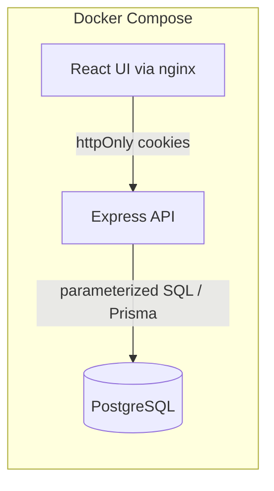
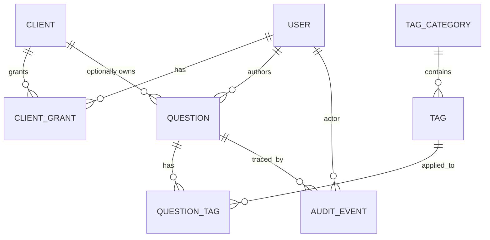

# Interview Question Bank — Stage 1: Requirements Analysis

Status: **Stage 1 analysis, kept as the original record. The §8 decisions are closed: see the decision log in `02-technology-selection.md` §1. Requirement → task mapping is in `04-task-plan.md`; what is built and verified is in `05-progress.md`. Corrections made on 2026-10-16 to match the build are marked "Built:" or "At Stage 1".**
Source: `Khushal-interview-question-bank.md` (the POC brief). Stack fixed by the brief: PostgreSQL + Prisma; Express *or* Next.js is open.

---

## 0. Materials and environment (what I actually checked, at Stage 1; the repo has since been built)

| Item | Finding |
|---|---|
| POC brief | Provided inline in the chat (all 8 sections read). No other files were supplied. |
| Project directory | At Stage 1, `interview-qb/` was **empty and not a git repo**. It is now a git repo with the API, web UI and Docker setup built (T-01..T-23). |
| Docker | Client 28.4.0, daemon running (Docker Desktop), Compose v2.39.4. |
| Node | v22.19.0 (current LTS line). |
| Not accessed | The second workspace folder (LMNL teacher-directory) is unrelated; I did not open it. |

---

## 1. Project overview

**Problem.** Interview/screening questions live in private documents. Nobody can search across them, and client-specific questions have no access control.

**Objective.** A shared, searchable question bank where questions carry answer notes and multi-category tags, and client-specific questions are visible only to users granted that client.

**Users.** Authors (add + edit own), Reviewers (edit any), Users (read-only). Client-scoped grants cut across all three roles.

**Centre of gravity (from §1 of the brief).** Authorization that does not leak through search. A happy-path demo that works but lets a filtered query hint at a restricted question is a failed POC.

**POC outcome.** An API (plus a thin UI, if approved) that starts with `docker compose up`, with automated tests proving: (a) the visibility guarantee, (b) edit permissions by ID, (c) search stays DB-side at several thousand rows.

**Out of scope unless approved:** delete/archive, user registration/self-service, SSO, tag administration UI, the §8 optional items.

---

## 2. Requirements register

Classification key: **E** = explicit in brief · **I** = implied by the brief · **R** = recommended engineering addition (mine, not from the brief) · **O** = optional (§8 of the brief).
"Implementation area" uses the phase names from §7 below; Stage 4 will attach concrete task IDs.

### 2.1 Functional

| ID | Requirement | Cat. | Pri. | Acceptance criteria | Impl. area | Verification |
|---|---|---|---|---|---|---|
| FR-01 | Create a question with question text, answer notes, tags (§3.1) | E | Critical | `POST /questions` with valid body → 201; row + tags persisted | Core features | API integration test |
| FR-02 | Many tags per category, many categories per question; a tag applies to many questions (§3.1, §4) | E | Critical | Question with 2 technology + 1 seniority tag round-trips intact | DB schema, Core | Integration test + schema review |
| FR-03 | Filter: any combination of categories, multi-value within a category (OR within, AND across) (§3.2) | E | Critical | `tech∈{React,Node} AND seniority∈{Mid,Senior}` returns exactly the matching set | Core (search) | Integration test on seeded data |
| FR-04 | Filter executes in the database as one query, not client-side/in-memory (§3.2, §6) | E | Critical | No code path loads the full table; `EXPLAIN` shows index use. Built: filter + keyword + visibility are one `WHERE`; the page and the count are two statements sharing it | Core (search), Perf | Query-plan check + code review |
| FR-05 | Keyword search over question text **and** answer notes (§3.3) | E | Critical | Keyword present only in notes still matches | Core (search) | Integration test |
| FR-06 | Keyword + filters compose in one query (§3.2–3.3, §6) | I | High | Combined request returns the intersection | Core (search) | Integration test |
| FR-07 | Client-restricted questions visible only to users with a grant for that client (§3.4) | E | Critical | See SEC-04 | DB schema, Core | SEC-04 test |
| FR-08 | Client-scoped permission grants (user ↔ client) exist as data (§2, §4) | E | Critical | Grant table; seed has permitted and unpermitted users | DB schema | Seed + tests |
| FR-09 | Author may edit only their own entries (§3.5) | E | Critical | Author A edits own → 200; edits B's → rejected | Auth, Core | AUTH-03 test |
| FR-10 | Reviewer may edit any visible entry (§3.5) | E | Critical | Reviewer edits any visible entry → 200 | Auth, Core | AUTH-03 test |
| FR-11 | Everyone else is read-only; edit attempts rejected by the **API** (§3.5) | E | Critical | `USER` role `PATCH` → 403; UI hiding is irrelevant | Auth | AUTH-03 test |
| FR-12 | Near-duplicate check on submission; match surfaced, not silently stored (§3.6) | E | High | Submitting a near-copy returns a duplicate response listing matches; nothing stored | Core | Integration test |
| FR-13 | The "closely duplicates" rule is decided **and documented** (§3.6) | E | High | Rule + threshold in ADR and README | Docs | Doc review |
| FR-14 | False-positive path decided and documented (§3.6) | E | High | Explicit override request stores the question and records the override | Core, Docs | Integration test |
| FR-15 | Every addition and edit recorded with who and when (§3.7) | E | Critical | Each create/edit writes a history row in the same transaction | DB schema, Core | Integration test |
| FR-16 | Read a single question and its history | I | Medium | `GET /questions/:id`, `GET /questions/:id/history` | Core | Integration test |
| FR-17 | Pagination with stable ordering on list/search | I | High | `limit/offset` (or cursor) with deterministic sort | Core | Integration test |
| FR-18 | List available categories/tags so clients can build filters | I | High | `GET /tags` returns categories and values | Core | Integration test |

### 2.2 Security, validation, audit (brief §6)

| ID | Requirement | Cat. | Pri. | Acceptance criteria | Impl. area | Verification |
|---|---|---|---|---|---|---|
| SEC-01 | Bad input rejected **before business logic**: empty text, nonexistent tag category, missing auth on edit (§6) | E | Critical | Schema validation middleware returns 400/401 before the service runs | Backend foundation | Validation tests assert 400 and nothing written (Built: no service spy) |
| SEC-02 | No anonymous path; every add/edit/search tied to an authenticated user (§6) | E | Critical | All routes except login/health return 401 without a valid credential | Auth | Route-sweep test: enumerate routes, assert 401 |
| AUTH-03 | Author/Reviewer/User edit matrix proven by **test, including direct-by-ID** attempts (§6) | E | Critical | Automated test matrix 3 roles × own/other entry | Testing | Integration test (real DB) |
| SEC-04 | **Search by a user without client permission, using a keyword that matches only that client's questions, returns a response indistinguishable from a genuine zero-match** (§3.4, §6) | E | Critical | Response status, body shape, pagination fields, and headers equal those of a keyword matching nothing anywhere; a permitted user *does* see the match (positive control) | Core, Testing | Dedicated integration test on real Postgres |
| NFR-01 | Combined filter and keyword search remain usable at several thousand rows; no load-all-and-filter (§6) | E | Critical | Seeded ≥5,000 rows; `EXPLAIN ANALYZE` uses indexes; latency target in §4 | Perf | Seed + query plan + timing |
| AUD-01 | Every addition, edit, and **rejected duplicate submission** leaves a structured who/when trace (§6) | E | High | History/audit row + structured log line for all three event types | Core, Observability | Integration test asserting rows + log output |
| OPS-01 | Entire system starts with `docker compose up`; only a documented `.env` needed (§6) | E | Critical | Fresh clone + `.env` copy → healthy stack, migrated, seeded | Docker | Clean-clone run |

### 2.3 Implied requirements that decide the design (I)

These are not stated in the brief but follow directly from §3.4. Skipping them reintroduces the leak.

| ID | Requirement | Pri. | Rationale | Verification |
|---|---|---|---|---|
| IMP-01 | The visibility predicate applies on **every** read path, not just search: get-by-ID, history, duplicate matches, tag/facet counts, pagination totals | Critical | Any of these can reveal a restricted question's existence | One test per path |
| IMP-02 | An invisible question returns the **same 404** as a nonexistent ID, on both `GET` and `PATCH` (never 403) | Critical | 403 vs 404 confirms existence to someone probing IDs | Test: restricted-ID vs random-ID responses are identical |
| IMP-03 | Editing requires visibility first, then role. A Reviewer without a grant cannot edit (or see) that client's questions | High | §2 says both roles read "what they're permitted to see" | Test |
| IMP-04 | Duplicate detection compares only against rows visible to the submitter. No DB unique constraint on question text | Critical | A `UNIQUE` violation or a "duplicate of #812" message would reveal a restricted question | Test: restricted near-duplicate submitted by unpermitted user is accepted silently |
| IMP-05 | A question's client is set at creation only (requires a grant for that client) and is **immutable afterwards** | High | Re-scoping would expose restricted content (and its history) to everyone, or hide it from its author | Tests: grant check on create; PATCH containing `clientId` → 400 |
| IMP-06 | Fixed taxonomy: categories (and tag values) are seeded; clients cannot invent categories | High | "A tag category that doesn't exist" must be rejectable (§6) | Validation test |
| IMP-07 | A rejected duplicate creates no question, so the audit trail needs an event that is not tied to a question row (nullable `question_id`) | High | Required to satisfy AUD-01 | Test |
| IMP-08 | `clientId` as a filter parameter for an unpermitted client behaves like a nonexistent client | High | Else it is a client-existence oracle | Test |

### 2.4 Recommended additions (R — mine, not in the brief)

| ID | Item | Why | Cost |
|---|---|---|---|
| R-01 | Zod request validation at the route boundary | Delivers SEC-01 with typed schemas shared with the UI | Low |
| R-02 | Argon2id password hashing, JWT access token | Needed to have real authenticated users (brief gives no auth mechanism) | Low |
| R-03 | `helmet`, CORS allow-list, rate limit on login and search | OWASP baseline | Low |
| R-04 | pino structured logging with request IDs and redaction | Makes AUD-01 traceable, no tokens in logs | Low |
| R-05 | Postgres Row-Level Security as a second enforcement layer | Defence in depth if someone later writes a query that skips the predicate | Medium, optional. **Deferred, not built** (ADR-005); an architecture-guard test is used instead |
| R-06 | OpenAPI doc generated from Zod schemas | Walkthrough aid | Low-Med. **Built** (Swagger UI at `/api/docs`, spec at `/api/openapi.json`) |
| R-07 | GitHub Actions: lint, typecheck, test against a Postgres service | Repeatable proof of tests | Low. **Not built** |
| R-08 | Minimal React UI (Vite) | Demo-ability; brief does not require one. **Decided yes (D2); built** (T-19, T-21..T-23) | Medium |

### 2.5 Optional (O — brief §8, not in scope unless you ask)

| ID | Item |
|---|---|
| O-01 | 10k-row load test, query plan, added indexes |
| O-02 | Second client; user permitted for one and not the other, searching across both |
| O-03 | "Suggested edit" flow reusing the same history mechanism |

Note: NFR-01 will already produce a basic query plan. O-02 is nearly free if the seed contains two clients from the start (recommended).

---

## 3. Ambiguities, contradictions, assumptions

| # | Issue | Type | Default assumption (override if you disagree) |
|---|---|---|---|
| A1 | §1 says "**anyone** can add a question"; §2 says only Authors add and Users are read-only | **Contradiction** | §2/§3.5 govern: only `AUTHOR` and `REVIEWER` can create. `USER` cannot. |
| A2 | §2 lists Reviewer as edit-any + read; never says Reviewers can add | Gap | Reviewers can also add (superset of Author). |
| A3 | Your prompt says MERN; the brief fixes PostgreSQL + Prisma | Tension | The brief wins. I still run the SQL vs NoSQL comparison in Stage 2 for the walkthrough, but the outcome is predetermined. |
| A4 | Express vs Next.js is left open | Open choice | **Decided: Express 5** (D1). |
| A5 | No UI required by the brief | Gap | **Decided: minimal React UI** after the API and tests were green (D2); built. |
| A6 | No authentication mechanism specified | Gap | Seeded users, email + password (Argon2id), short-lived JWT access token plus rotating refresh token, both in httpOnly cookies (D3, ADR-006). No self-registration. |
| A7 | Roles global or per-client? | Gap | One global role per user (`USER`/`AUTHOR`/`REVIEWER`); client grants are a separate table. |
| A8 | Do Reviewers bypass client grants? | Ambiguity | **No bypass** (IMP-03). Safer reading of "permitted to see". |
| A9 | "Closely duplicates" undefined (§3.6) | Deliberate gap | Trigram similarity on normalized text with a threshold, see §6. Tuned against seed data. |
| A10 | False-positive behaviour undefined | Deliberate gap | Resubmit with `confirmNotDuplicate: true`; recorded in audit. |
| A11 | "Keyword" semantics undefined | Gap | Postgres full-text search (English stemming), AND of terms across question text + answer notes. Not substring match. |
| A12 | Who creates tags/clients/grants? | Gap | Seeded only. No admin endpoints in POC. |
| A13 | Delete not mentioned | Gap | No delete. History would need soft-delete semantics; not worth it. |
| A14 | "Several thousand" has no number | Gap | Seed 5,000 for tests; 10,000 for the optional load test. |
| A15 | Timing side-channels (restricted queries slower/faster) | Known limit | Out of scope; documented as an accepted limitation. Response *content* indistinguishability is what is tested. |
| A16 | Visibility trade-off: a user cannot be warned about a duplicate of a question they cannot see | Consequence of IMP-04 | Accepted. Leak-avoidance outranks dedupe completeness. |

---

## 4. Non-functional requirements

"Source" = stated in the brief. "Proposed" = my target, not from the brief.

| Area | Requirement | Source / Proposed |
|---|---|---|
| Security | Authentication on all non-health routes; authorization in DB predicate, not display layer | Source |
| Security | Argon2id, helmet, CORS allow-list, rate limits, no secrets/tokens in logs | Proposed |
| Performance | Usable at several thousand rows, DB-side filtering | Source |
| Performance | p95 < 200 ms for combined filter + keyword at 10k rows on a laptop, measured not assumed | Proposed. **Not measured at 10k.** Measured once at 5,004 rows: 19.5 ms combined, 1.3 ms filter-only, single warm run, not a p95 (`docs/perf.md`) |
| Data integrity | Question + tags + history written in one transaction; FK constraints; unique `(category, value)` | Proposed (implied by §3.7) |
| Reliability | Postgres healthcheck gates API start; migrations run on boot; graceful shutdown | Proposed |
| Observability | Structured trace of who/when for add, edit, rejected duplicate | Source (AUD-01) |
| Observability | Request-ID correlation, `/health` endpoint | Proposed |
| Testability | Tests run against real Postgres (not mocks); §3.4 test has a positive control | Proposed (my reading of §6) |
| Accessibility | Semantic HTML, labelled form controls, keyboard operable filters — only if UI is built | Proposed |
| Maintainability | Single query-builder module owns visibility; strict TypeScript | Proposed |
| Scalability | Index-backed queries; pagination; no horizontal-scale work in POC | Proposed |

---

## 5. Technology-evaluation approach (Stage 2 preview)

I will score each candidate against: requirement fit, your familiarity, complexity, security, time (2 weeks), and extensibility. Preliminary leanings, to be defended in Stage 2 ADRs:

| Decision | Leaning | Reason |
|---|---|---|
| Database | **PostgreSQL** (brief-mandated) | The brief fixes it. Independently justified: many-to-many joins, `EXISTS` subqueries, GIN full-text, `pg_trgm`, transactions, optional RLS. MongoDB would force application-side joins and denormalized tag arrays; it makes the access-control predicate harder to prove, not easier. |
| API framework | **Express + TypeScript** | The POC is API-centric and security-focused; Next.js route handlers add SSR/App Router concepts that do not serve any requirement. Express keeps middleware ordering (auth → validate → authorize → service) explicit and easy to explain. Matches your MERN background. |
| ORM | **Prisma** (brief-mandated) + `$queryRaw` for search | Prisma's query API cannot express tsvector `@@`, trigram `similarity()`, or this `EXISTS` shape cleanly. Use Prisma for schema, migrations, simple CRUD. Use parameterized tagged-template raw SQL for the search/dup queries. **Must verify against current Prisma docs in Stage 2 (generated tsvector column, `Unsupported` types, raw-migration workflow); I have not checked yet.** |
| Validation | Zod | One schema for runtime validation and TS types; reusable in the UI |
| Frontend (if approved) | React + Vite + TanStack Query, minimal | Server state is the only real state; no Redux/Zustand needed |
| Testing | Vitest + Supertest against a real Postgres container | Meets §6 "prove with a test"; Playwright only if UI exists and time remains |
| Auth | Seeded users; JWT access + rotating refresh tokens **in httpOnly cookies** (not Bearer; decided in Stage 2, D3 / ADR-006) | Real authenticated identity with nothing readable by JS |

---

## 6. Architecture outline (design direction for the hard part)

### 6.1 Shape



Request path (Built: no CORS, single origin behind nginx): `requestId → pino → helmet → Origin check → auth (cookie JWT → user loaded by id) → Zod validate / role check → service → question.repo (only code touching questions) → DB`.

### 6.2 Core rule

**One module owns every read of `question`. It takes the acting user as a required argument and bakes the visibility predicate into the `WHERE` clause.** No route, service, or test helper queries `question` any other way. This is the answer to "show me where the exclusion happens".

```
visible(q, user) :=  q.client_id IS NULL
                  OR EXISTS (SELECT 1 FROM client_grant g
                             WHERE g.user_id = :user AND g.client_id = q.client_id)
```

### 6.3 Data model (to be finalised in Stage 3)



| Table | Key points |
|---|---|
| `question` | `id`, `text`, `answer_notes`, `author_id`, `client_id NULL`, GIN expression indexes for full-text (text + notes) and trigram (normalised text); no generated columns (superseded by the T-03 spike, see ADR-003). **No unique constraint on text** (IMP-04). |
| `tag_category` / `tag` | `tag UNIQUE(category_id, value)`. Seeded. |
| `question_tag` | PK `(question_id, tag_id)` plus a reverse index `(tag_id, question_id)`. |
| `client_grant` | PK `(user_id, client_id)`. Makes the visibility `EXISTS` a primary-key lookup. |
| `refresh_token` | Added in Stage 2/3 (ADR-006): `id` = JWT `jti`, `family_id`, SHA-256 `token_hash`, `used_at`, `revoked_at`. Not in this Stage 1 diagram. |
| `audit_event` | `type` (`QUESTION_CREATED`, `QUESTION_UPDATED`, `DUPLICATE_REJECTED`, `DUPLICATE_OVERRIDDEN`), `actor_id`, `at`, `question_id NULL`, `payload JSONB` (diff/snapshot or the matched IDs). One table serves AUD-01 and keeps the §8 "suggested edit" option on the same mechanism. |

### 6.4 Filter query shape

Each selected category becomes one `EXISTS` on `question_tag` with `tag_id = ANY($ids)`: OR within a category, AND across categories. Combined with the visibility predicate and an optional full-text `@@ websearch_to_tsquery(...)` predicate, in one `WHERE` with `LIMIT/OFFSET`. Built: the page and the total count are two statements sharing that `WHERE` (keeps `total` correct past the last page). The alternatives I will weigh in Stage 2: `int[]` tag column + GIN (fast, but breaks referential integrity), JSONB tags (same problem), EAV (worse).

### 6.5 Duplicate rule (proposal)

Normalize (lowercase, strip punctuation, collapse whitespace). Flag if `pg_trgm similarity ≥ 0.6` against **visible** questions (threshold tuned on seed data, which I will report honestly). On a hit: `409 DUPLICATE_SUSPECTED` with up to 5 matches and nothing stored, audit row `DUPLICATE_REJECTED`. Author insists: resubmit with `confirmNotDuplicate: true` → stored, audit row `DUPLICATE_OVERRIDDEN`.

### 6.6 Defence in depth (ADR candidate)

Postgres RLS keyed on `SET LOCAL app.user_id`, so a forgotten predicate returns nothing instead of leaking. Pros: independent of app code. Cons: more moving parts with Prisma connection pooling and transactions; harder to debug. I would make this optional and decide after the core is green.

---

## 7. Phased roadmap (outline; the full task table comes in Stage 4)

| Phase | Content | Depends on |
|---|---|---|
| P0 | Decisions approved, repo init + branching | This document |
| P1 | Tooling: TS strict, lint, Vitest | P0 |
| P2 | Docker: Compose, Postgres healthcheck, `.env.example` | P1 |
| P3 | Schema, migrations (incl. raw SQL for tsvector/trigram/GIN), seed (5k rows, 2 clients, 3 roles) | P2 |
| P4 | Backend foundation: config, logging, error handler, Zod middleware, auth | P3 |
| P5 | **Query builder with visibility predicate + SEC-04 test written first** | P3, P4 |
| P6 | Create/edit/history/duplicate flow + authorization matrix tests | P5 |
| P7 | Hardening: rate limits, helmet, route-sweep 401 test, audit log assertions | P6 |
| P8 | Performance: `EXPLAIN ANALYZE` at 5k/10k, indexes justified | P5 |
| P9 | Minimal UI (if approved) | P6 |
| P10 | Docs, README, walkthrough script (maps to §7 questions of the brief) | all |
| P11 | Clean-clone verification and sign-off report | all |

Critical path: P3 → P4 → **P5** → P6 → P10. P5 is where the POC is won or lost, so it goes before any CRUD polish.

Git (planned): trunk-based, short-lived `feat/*` branches, squash-merge, one PR per phase. Built: one branch with five commits and no PR yet; see `04-task-plan.md`.

---

## 8. Decisions needed from you (all closed; answers in `02-technology-selection.md` §1: D1 Express, D2 minimal UI, D3 cookie JWT, D4 no reviewer bypass, D5 trigram 0.6, D6 two clients + RLS deferred)

1. **Express or Next.js?** Recommend Express.
2. **UI scope.** (a) API + tests only, (b) minimal React UI after API is green (recommended), (c) full UI.
3. **Role/auth model.** Seeded users + Argon2id + JWT, global role, no self-registration — OK? And confirm A1: `USER` cannot create questions despite §1's "anyone".
4. **Reviewer vs client grants.** Reviewers need a grant like everyone else (recommended, A8) — OK?
5. **Duplicate rule and override.** Trigram ≥ 0.6 on visible rows, override flag recorded in audit — OK?
6. **Optional extras.** Include a second client in the seed from day one (cheap, gives O-02)? Include Postgres RLS (R-05)?

Anything you do not answer, I will proceed with the stated default and record it in the assumptions register.
