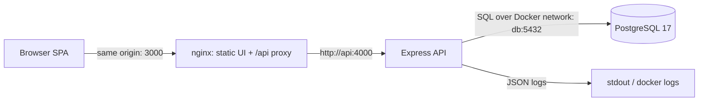
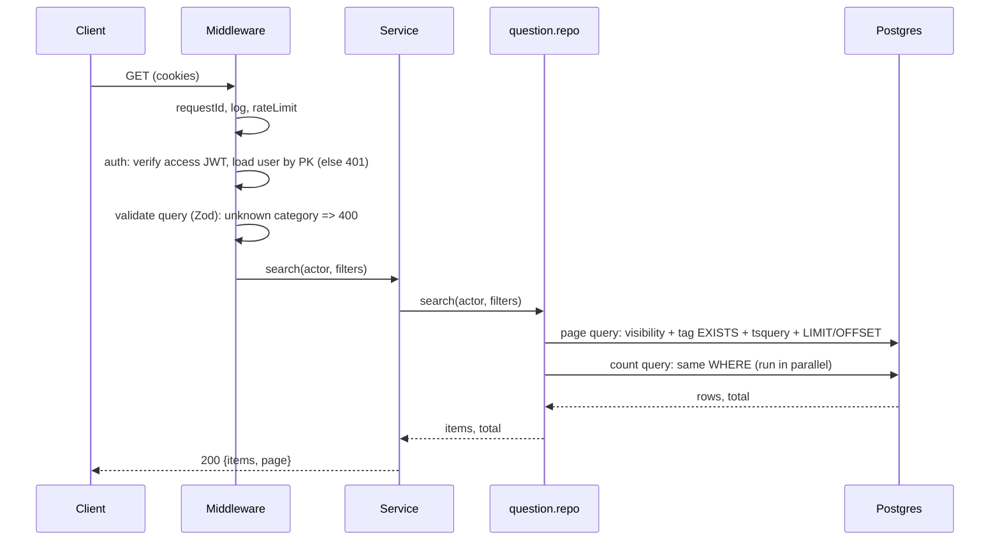
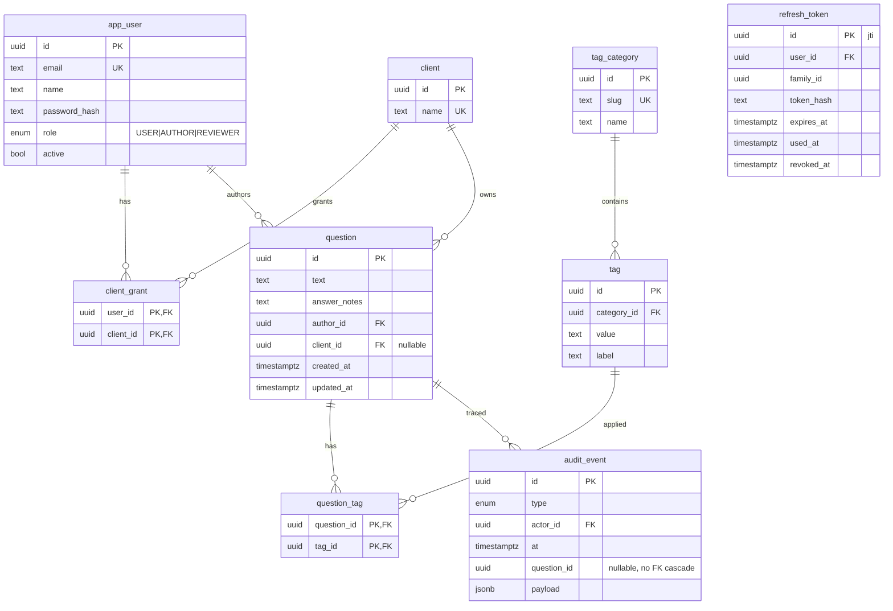

# Stage 3 — Architecture, API Contract, Data Model, Security

Status: **Implemented (T-01..T-23). Written before the code and corrected against the code on 2026-10-16; where the build differs from the original plan the text says so.** Decisions referenced (D#, ADR-#) are in `02-technology-selection.md`. What is verified: `05-progress.md`.

## Glossary

| The product says | The code and API say | Notes |
| --- | --- | --- |
| Department | `client` (table `client`, paths `/clients`, `/admin/clients`, response field `client`) | The original brief called it a client. The names stayed in the data model and URLs; the UI and docs say department. |
| Department filter / department of a question | `clientId` | One name everywhere: the question list URL (`?clientId=`), the API query and the request bodies. |
| Global question | `client` is `null` | Visible to every signed-in user (subject to review status). |
| Technology | a `tag` in the category `technology`, linked to departments through `client_tag` | "Other" is the list of technologies no department uses. |
| Retire / archive | `archivedAt` on a tag | Retiring hides a technology; archiving a department hides the technologies only it used (`archivedByClientId`). |
| Delete (admin) | `deletedAt` (soft delete) | Restorable from the admin pages. |

## 1. System architecture



Data flow: the browser only ever talks to nginx. Cookies are therefore first-party and `SameSite=Strict` works; no CORS is configured. nginx forwards `/api/*` to the `api` container by service name. The API trusts `X-Forwarded-For` only for the number of proxy hops in `TRUST_PROXY` (Compose sets 1 for nginx; the default is 0), so rate limiting keys on the real client IP and a client reaching the API directly cannot choose its own key.

## 2. Backend layout (`apps/api/src`)

```
src/config/    env parsing (Zod), fails fast on bad .env
src/http/      app.ts (request id + pino-http + helmet + body/cookie parsing), csrf.ts (Origin check), validate.ts, errors.ts
src/modules/
  auth/        routes (login rate limit), service (login/refresh/logout), tokens, cookies, password, middleware (requireAuth/requireRole)
  questions/   routes (per-user rate limit), service, question.repo.ts  <- ONLY file that reads the question tables
  tags/        routes (GET /tags), tags.ts (tag string parser + category:value -> ids)
  clients/     routes (GET /clients: only the caller's grants)
  audit/       audit.repo.ts (write inside the caller's transaction; history read)
src/docs/      openapi.ts (OpenAPI 3.1 built from the Zod schemas), routes.ts (Swagger UI + spec)
src/db/        prisma client (driver adapter)
src/seed/      deterministic seed (data.ts, seed.ts, run.ts)
prisma/        schema.prisma, migrations/ (hand-written SQL for the GIN indexes and the CHECK)
test/          globalSetup (creates and migrates qb_test), helpers/fixture world, integration tests
```

Layers: **route** (wire + `validate(schema)`), **service** (business rules, transactions, audit), **repo** (SQL). No separate controller layer: route handlers are 5-10 lines, so a controller would only rename them. Rate limiting is applied inside the auth and questions routers, not in `http/`.

### Request lifecycle (`GET /api/questions?q=closure&tags=technology:react`)



Order matters: **auth → validate → authorize → service**. Validation runs before business logic (SEC-01). For `POST /questions` the role gate runs before body validation (a read-only user gets 403 whatever the body); `PATCH` validates, then the service checks visibility and then role. The original plan was to prove SEC-01 by spying on the service; the tests instead assert that each bad input is a 400 **and nothing was written** (`questions.write.test.ts`, `visibility.test.ts`). The page and count queries both carry the visibility predicate; the plan said "one statement", but two keep `total` correct when the offset is past the end.

## 3. API contract

Base path `/api`. JSON only. All routes except `login`, `refresh`, `logout`, the health probes, `/metrics` (its own bearer token) and the docs require a valid access cookie (401 otherwise; SEC-02). Success bodies wrap the resource: `GET/POST/PATCH /questions...` return `{question}`; `GET /questions/:id/history` returns `{items:[{id,type,at,actor:{id,name},changes?}]}` (`changes` only on `QUESTION_UPDATED`). The questions API also has a per-user rate limit (default 120/min, `RATE_LIMIT_API_PER_MIN`) that returns 429 `RATE_LIMITED` and deliberately sends no `RateLimit-*` headers, since a decrementing counter would make hidden and genuinely empty search responses differ (SEC-04).

| Method | Route | Purpose | Auth / authorization | Success | Errors |
|---|---|---|---|---|---|
| GET | `/health`, `/health/live`, `/health/ready` | `/health` pings the DB; `live` answers without touching it (container liveness); `ready` checks the DB (traffic readiness) | none | 200 `{status:"ok"}` | 503 |
| GET | `/metrics` | Prometheus metrics (request counts and durations by route pattern, process stats) | `Authorization: Bearer $METRICS_TOKEN`; **404 unless `METRICS_TOKEN` is set** | 200 | 401 |
| GET | `/docs`, `/openapi.json` | Swagger UI and the OpenAPI 3.1 spec (contract only, no data); **off by default in production** (`DOCS_ENABLED`) | none | 200 | |
| POST | `/auth/login` | email + password → cookies | none; rate-limited 5/min per IP+email and 30/min per IP | 200 `{user}` + 2 cookies | 400, 401 (same body for bad email/password), 429 |
| POST | `/auth/refresh` | rotate refresh token → new cookies | refresh cookie; 30/min per IP | 204 + cookies | 401 (reuse revokes family) |
| POST | `/auth/logout` | revoke family, clear cookies | refresh cookie (idempotent) | 204 | |
| GET | `/auth/me` | current user `{id,name,email,role}` | access cookie | 200 | 401 |
| GET | `/tags` | categories with values; `?for=filter` narrows Technology to the caller's departments and drops archived | authenticated | 200 `{categories:[{slug,name,tags:[{value,label,archived,other?}]}]}` | 401 |
| GET | `/clients` | departments the **caller** is granted, each with its active technology values | authenticated | 200 `{items:[{id,name,technologies}]}` (only granted) | 401 |
| GET | `/questions` | search + filter, paginated (`mine=true` narrows to your own) | authenticated; visibility in SQL | 200 `{items,page}` | 400, 401, 429 |
| GET | `/questions/summary` | what is waiting: the reviewer queue size and your own questions by status (drives the sidebar badges) | authenticated | 200 | 401 |
| GET | `/notifications` | your latest 50 notifications (a decision on your question) and the unread count; the question text only while you can still see it | authenticated | 200 `{items,unreadCount}` | 401 |
| POST | `/notifications/read` | mark some (`ids`) or all (`all: true`) read | authenticated | 204 | 400, 401 |
| GET | `/questions/:id` | one question | visibility in SQL; invisible ≡ nonexistent | 200 | 400 (bad uuid), 401, **404** |
| GET | `/questions/:id/history` | audit events for the question | visible first, then 404 otherwise | 200 `{items}` | 401, **404** |
| POST | `/questions` | create | role AUTHOR/ADMIN; grant if `clientId`; a department question may only use its department's technologies | 201 | 400, 401, 403 (role), 404 (unknown/ungranted client, identical), **409 duplicate** |
| PATCH | `/questions/:id` | partial edit; send `expectedUpdatedAt` (the version you opened) to detect a concurrent edit | visible → else 404; then AUTHOR owns it or REVIEWER; else 403 | 200 | 400, 401, 403, 404, **409 `EDIT_CONFLICT`** (someone else saved first), 409 duplicate (override with `confirmNotDuplicate`) |

| DELETE | `/questions/:id` | soft delete (history kept) | ADMIN (any); an AUTHOR may withdraw their own until it is approved; visibility first | 204 | 401, 403, 404 |
| POST | `/questions/:id/review` | approve or reject with a note | REVIEWER (pending, not own) or ADMIN; visibility first | 200 `{question}` | 400, 403, 404, **409 NOT_PENDING** |

**Admin routes** (`/admin/*`; every one is ADMIN-only, enforced once for the whole router; 429 after 120/min per user, shared with `/tags` and `/clients`):

| Method | Route | Purpose |
|---|---|---|
| GET / POST | `/admin/users` | list: search `q` (name or email fragment), filters `role`, `active` (`true`/`false`) and `clientId` (people granted that department), `?deleted=true`, cursor paging (`limit`, `cursor`) / create with an initial password |
| PATCH / DELETE | `/admin/users/:id` | edit name, email, role, active, password / soft delete (409 `LAST_ADMIN` if it would leave no active admin) |
| POST | `/admin/users/:id/restore` | restore a deleted user, **inactive** until an admin activates them |
| PUT | `/admin/users/:id/clients` | replace the departments a user may see |
| GET / POST | `/admin/clients` | list (`?deleted=true`) / create a department |
| PATCH / DELETE | `/admin/clients/:id` | edit / soft delete (archives technologies only it used) |
| GET | `/admin/clients/:id/impact` | what a delete would hide: questions, pending, users, technologies |
| POST | `/admin/clients/:id/restore` | restore (brings back the technologies that delete archived) |
| GET / POST | `/admin/clients/:id/technologies` | the department's active, archived and addable technologies / add (links an existing name or creates) |
| DELETE / POST | `/admin/clients/:id/technologies/:tagId[/restore]` | remove (unlink if shared, archive if exclusive) / restore |
| PATCH | `/admin/technologies/:id` | rename (label only) |
| GET | `/admin/technologies/other` | technologies no live department uses ("Other") |
| POST | `/admin/technologies/:id/archive` and `/restore` | archive or restore an "Other" technology |
| GET | `/admin/deleted-questions` | deleted questions, newest deletion first, cursor paging |
| POST | `/admin/questions/:id/restore` | restore (409 `DEPARTMENT_DELETED` while its department is deleted) |
| GET | `/admin/tag-categories` | the lists other than technology (seniority, type) with usage counts |
| POST | `/admin/tag-categories/:slug/tags` | add a tag to such a list |
| PATCH | `/admin/tags/:id` | rename a non-technology tag (its `value` stays, so saved links keep working) |
| POST | `/admin/tags/:id/archive` and `/restore` | archive hides it from pickers; questions keep it |
| GET | `/admin/audit` | the audit trail, newest first: filter by `type`, `actorId`, `from`, `to`; cursor paging |
| GET | `/admin/audit/export` | the same filters as CSV (capped at 5,000 rows; cells that could run as spreadsheet formulas are defused) |

**Why 403 vs 404 order on PATCH:** visibility first. A `USER`/other-author editing a *visible* question gets 403 (they know it exists, no leak). Any edit of an *invisible* question gets 404, same as a random ID.

**`GET /questions` query:** `q` (≤200 chars, `websearch_to_tsquery`), `tags` (comma list of `category:value`, grouped by category server-side: OR within, AND across), `clientId` (uuid; just an extra predicate: ungranted ≡ nonexistent ≡ zero rows), `mine` (`true`: only your own), `status`, `limit` (1-50, default 20), `offset` (0-10,000; deeper than that is a 400 and the UI asks for a narrower search). Sort: `ts_rank` desc when `q` present, else `created_at` desc; tiebreak `id`. Unknown category → 400; unknown value in a known category → 400.

**Response shapes**
```jsonc
// 200 GET /questions
{ "items": [{ "id", "text", "answerNotes", "client": {"id","name"}|null,
              "tags": [{"category","value"}], "author": {"id","name"},
              "createdAt", "updatedAt" }],
  "page": { "limit": 20, "offset": 0, "total": 0 } }
// error (identical body for invisible and nonexistent; no requestId in body)
{ "error": { "code": "NOT_FOUND", "message": "Question not found" } }
// 409
{ "error": { "code": "DUPLICATE_SUSPECTED", "message": "...", "matches": [{"id","text","similarity"}] } }
```
`X-Request-Id` goes in a **header** so bodies are byte-identical for the SEC-04 and IMP-02 tests.

**`POST /questions` body:** `{ text: string 1..1000 (trimmed), answerNotes?: string ≤10000, clientId?: uuid, tags: string[] ("category:value"), confirmNotDuplicate?: boolean }`. **`PATCH`:** `text`, `answerNotes`, `tags` only, all optional, at least one required; unknown keys (including `clientId`) → 400. Duplicate check runs on create only (documented limitation; extending to edits is a one-line change).

**`clientId` is immutable.** It can be set on `POST` only (requires a grant; an ungranted `clientId` returns the same 404 as a nonexistent client). A `PATCH` body containing `clientId` is a 400. Re-scoping would expose restricted content and its history, or strand it from its author.

## 4. Data model



**Constraints:** `tag UNIQUE(category_id, value)`; `question.text` CHECK non-blank; **no unique on text** (ADR-007); FKs `ON DELETE RESTRICT`; deletes are soft (`deleted_at` on user, client, question) technologies are archived (`tag.archived_at`) and belong to departments through `client_tag(client_id, tag_id)`; everything is reversible by an admin.

**Indexes (each justified; re-justified by EXPLAIN in T-20):**

| Index | Serves |
|---|---|
| `question_tag (question_id, tag_id)` PK | loading a question's tags; the `EXISTS` probe |
| `question_tag (tag_id, question_id)` | tag → questions probe for the filter |
| `client_grant (user_id, client_id)` PK | visibility `EXISTS` is a PK lookup |
| GIN expression index `question_search_idx` (weighted `to_tsvector` of text + notes) | keyword search |
| GIN expression index `question_text_trgm_idx` (`gin_trgm_ops` over normalised text) | duplicate `%` / `similarity` |
| `question (created_at DESC, id DESC)` | default sort + pagination |
| `question (client_id)` | client filter, visibility join |
| `audit_event (question_id, at)` | history |
| `refresh_token (family_id)` | family revocation |

**No generated columns.** The spike (ADR-003) showed Prisma reports drift on generated columns, so search and trigram use expression indexes and `question.repo.ts` repeats the identical expressions. Implemented as `apps/api/prisma/migrations/*_init`; `prisma migrate diff` reports no drift.

**Migrations / seed:** `prisma migrate deploy` on API start. Seed is deterministic (seeded PRNG, no faker dependency): 11 users (1 ADMIN, 3 USER, 5 AUTHOR, 2 REVIEWER, with different department grant sets; `author.none` and `user` hold none), 6 departments stored as `client` rows (MERN, MEAN, Python, AI-ML, Data Engineering, DevOps), 30 tags in 3 categories (technology 21, seniority 4, type 5), about 1,500 generated questions (~15% global, the rest built only from their own department's technologies and topics) plus 4 **named fixtures** with unique marker keywords (`capybara` global, `zebrafish` MERN, `narwhal` AI-ML, and a `let/const/var` question for the duplicate demo) and 3 review-workflow demo rows (2 pending, 1 rejected). The seed has no force flag: it refuses to run on a non-empty DB (`--if-empty` makes that a silent skip, used on container start; it still adds the demo admin if missing).

**Retention:** audit and refresh-token tables grow unbounded; a cleanup of expired refresh tokens is noted as future work.

## 5. Security architecture (OWASP mapping)

| Concern | Control |
|---|---|
| A01 Broken access control | Visibility in SQL (ADR-005); role checks in service; 404-not-403 for invisible; architecture-guard test; route sweep |
| A02 Crypto / secrets | Argon2id; two independent JWT secrets from `.env`; `.env` git-ignored, `.env.example` committed; startup fails if secrets < 32 chars, if the two are equal, or if `COOKIE_SECURE=true` with the committed `dev-only` placeholders. Caveat: the login page's Demo accounts panel puts the demo password in the web bundle when `VITE_SHOW_DEMO_ACCOUNTS=true` (default in compose); local demo only |
| A03 Injection | Only bound parameters (`$queryRaw` tagged templates); `$queryRawUnsafe` banned by lint; Zod on every input |
| A04 Insecure design | Threat: probing existence via search, ID, counts, errors, duplicates (IMP-01..08) |
| A05 Misconfiguration | `helmet`, no stack traces in prod errors, `x-powered-by` off, minimal Docker images, non-root user |
| A07 Auth failures | Short access TTL; access tokens are bound to their session, so signing out, a replayed refresh token, deactivation or deletion ends them at once; rotating refresh with reuse detection; rate limits per IP+email, per IP and per user (optionally in a shared Redis store); uniform login errors; timing-equalised unknown user |
| A08 Integrity | Pinned deps, lockfile. CI runs `npm audit --omit=dev` and fails on critical; 4 high findings via the `prisma` CLI's transitive deps are accepted because the CLI is not in the runtime image, see `05-progress.md` |
| A09 Logging | pino; redact `cookie`, `set-cookie`, `password`, tokens; log who/what/when for audit events. The audit table is append-only (a database trigger refuses UPDATE and DELETE), and admins can browse and export it |
| CSRF | Strict cookies + same-origin + Origin check (ADR-006) |
| XSS | React escapes by default; no `dangerouslySetInnerHTML`; answer notes rendered as plain text; CSP set by helmet on the API and by nginx (`security-headers.inc`) on the UI, both `default-src 'self'`-based; tokens not readable by JS |

Known limitations to document: timing side channels (A15); refresh race across tabs; HS256 shared secret; no account lockout beyond rate limiting; no multi-factor sign-in, no self-service password change or reset (an admin sets passwords).

## 6. Frontend architecture (`apps/web/src`)

```
app/         AppShell, routes, queryClient, pages (not-found / route error)
features/
  auth/      LoginPage, RequireAuth, api + hooks (useMe, useLogin, canEdit)
  questions/ QuestionListPage, QuestionDetailPage, QuestionFormPage, QuestionForm, filters.ts, api + hooks
    components/  FilterPanel, TagPicker, QuestionRow, Pagination, chips, DuplicateDialog, HistoryList
shared/      api/client.ts (apiFetch, single-flight refresh), ui/ (Button, Field, Dialog, Icon, Toast, states.tsx for skeleton/empty/error), hooks/, lib/
```
Routing: `/login`, `/` (list), `/questions/new`, `/questions/:id` (detail + history), `/questions/:id/edit`; the controls to edit show only when `canEdit` allows (cosmetic: the API enforces). Server state only in TanStack Query; URL is the state for filters. Forms: React Hook Form + Zod schemas mirroring the API's.

## 7. Docker and ports

| Service | Container port | Host port | Notes |
|---|---|---|---|
| web (nginx-unprivileged) | 8080 | 3000 | the only URL users need |
| api | 4000 | 127.0.0.1:4000 | loopback only (curl/tests); the browser goes through nginx |
| db | 5432 | 127.0.0.1:5436 | loopback only; host side moved to avoid a local Postgres on 5432 |
| migrate | none | none | one-shot job the API waits for: `prisma migrate deploy`, optional demo seed (`SEED_ON_START`), first admin from `ADMIN_EMAIL` / `ADMIN_PASSWORD`. It is its own image target; the API image has **no Prisma CLI** |
| caddy | 80, 443 | 80, 443 | optional TLS front door: `docker compose --profile tls up -d`, see `deploy/Caddyfile` (set `TRUST_PROXY=2` behind it) |

`.env.example` keys: `POSTGRES_USER/PASSWORD/DB`, `POSTGRES_HOST_PORT`, `API_HOST_PORT`, `WEB_HOST_PORT`, `DATABASE_URL` (host-side only), `JWT_ACCESS_SECRET`, `JWT_REFRESH_SECRET`, `ALLOWED_ORIGINS`, `COOKIE_SECURE` (default `false`: Safari drops `Secure` cookies on http://localhost), `SEED_ON_START`, `SEED_PASSWORD`, `VITE_SHOW_DEMO_ACCOUNTS`. Optional, not in `.env.example`: `DOCS_ENABLED` (default true), `RATE_LIMIT_LOGIN_PER_MIN` (5), `RATE_LIMIT_API_PER_MIN` (120), `LOG_LEVEL`, `PORT`. The Docker command catalogue is `docs/docker.md`. Also: `ADMIN_EMAIL`/`ADMIN_PASSWORD`, `METRICS_TOKEN`, `REDIS_URL`, `DB_STATEMENT_TIMEOUT_MS`, `TRUST_PROXY`, `SITE_ADDRESS`. Backups: `scripts/backup.sh` and `scripts/restore.sh` (see `docs/docker.md`).
