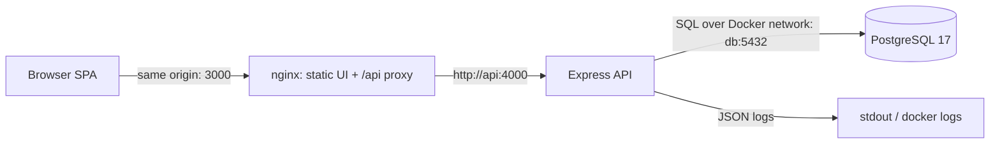
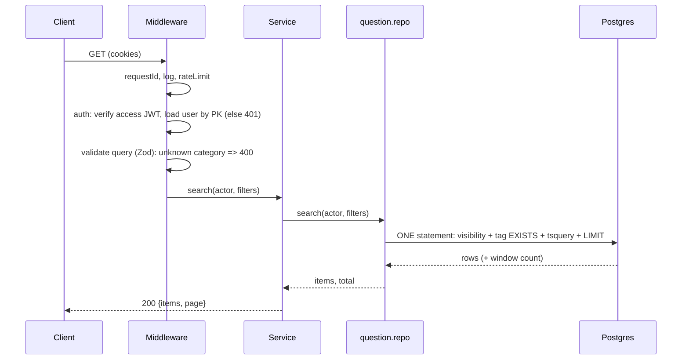
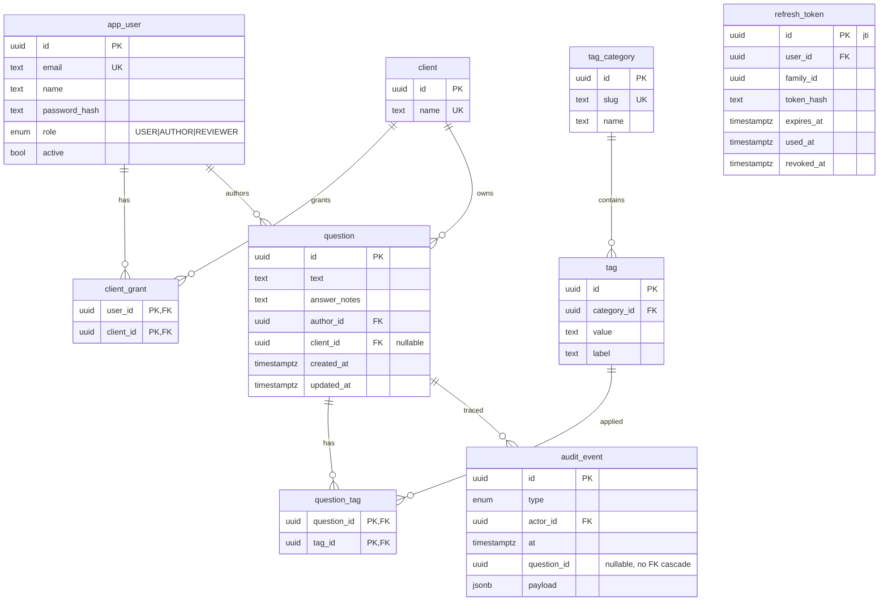

# Stage 3 — Architecture, API Contract, Data Model, Security

Status: **DRAFT for review. No implementation code exists.** Decisions referenced (D#, ADR-#) are in `02-technology-selection.md`.

## 1. System architecture



Data flow: the browser only ever talks to nginx. Cookies are therefore first-party and `SameSite=Strict` works; no CORS is configured. nginx forwards `/api/*` to the `api` container by service name. The API sets `trust proxy` so rate limiting keys on the real client IP from `X-Forwarded-For`, not nginx's.

## 2. Backend layout (`apps/api/src`)

```
config/        env parsing (Zod), fails fast on bad .env
http/          app.ts, middleware: requestId, logger, auth, csrfOrigin, validate, rateLimit, errorHandler
modules/
  auth/        routes, service (login/refresh/logout), token helpers
  questions/   routes, service, question.repo.ts  <- ONLY file that reads `question`
  tags/        routes (GET /tags), tagParser
  audit/       audit.repo.ts (write inside caller's transaction)
db/            prisma client, raw-SQL helpers
test/          setup, fixtures, integration tests
prisma/        schema.prisma, migrations/, seed.ts
```

Layers: **route** (wire + `validate(schema)`), **service** (business rules, transactions, audit), **repo** (SQL). No separate controller layer: route handlers are 5-10 lines, so a controller would only rename them.

### Request lifecycle (`GET /api/questions?q=closure&tags=technology:react`)



Order matters: **auth → validate → authorize → service**. Validation runs before business logic (SEC-01); the integration test spies on the service to prove it is not called on a 400.

## 3. API contract

Base path `/api`. JSON only. All routes except `login`, `refresh`, `health` require a valid access cookie (401 otherwise; SEC-02).

| Method | Route | Purpose | Auth / authorization | Success | Errors |
|---|---|---|---|---|---|
| GET | `/health` | liveness + DB ping | none | 200 `{status:"ok"}` | 503 |
| POST | `/auth/login` | email + password → cookies | none; rate-limited 5/min per IP+email | 200 `{user}` + 2 cookies | 400, 401 (same body for bad email/password), 429 |
| POST | `/auth/refresh` | rotate refresh token → new cookies | refresh cookie | 204 + cookies | 401 (reuse revokes family) |
| POST | `/auth/logout` | revoke family, clear cookies | refresh cookie (idempotent) | 204 | |
| GET | `/auth/me` | current user `{id,name,email,role}` | access cookie | 200 | 401 |
| GET | `/tags` | categories with values (non-sensitive, global) | authenticated | 200 `{categories:[{slug,name,tags:[{value,label}]}]}` | 401 |
| GET | `/clients` | clients the **caller** is granted | authenticated | 200 `{items}` (only granted) | 401 |
| GET | `/questions` | search + filter, paginated | authenticated; visibility in SQL | 200 `{items,page}` | 400, 401, 429 |
| GET | `/questions/:id` | one question | visibility in SQL; invisible ≡ nonexistent | 200 | 400 (bad uuid), 401, **404** |
| GET | `/questions/:id/history` | audit events for the question | visible first, then 404 otherwise | 200 `{items}` | 401, **404** |
| POST | `/questions` | create | role AUTHOR/REVIEWER; client grant if `clientId` | 201 | 400, 401, 403 (role), 404 (unknown/ungranted client, identical), **409 duplicate** |
| PATCH | `/questions/:id` | partial edit | visible → else 404; then AUTHOR owns it or REVIEWER; else 403 | 200 | 400, 401, 403, 404 |

**Why 403 vs 404 order on PATCH:** visibility first. A `USER`/other-author editing a *visible* question gets 403 (they know it exists, no leak). Any edit of an *invisible* question gets 404, same as a random ID.

**`GET /questions` query:** `q` (≤200 chars, `websearch_to_tsquery`), `tags` (comma list of `category:value`, grouped by category server-side: OR within, AND across), `clientId` (uuid; just an extra predicate: ungranted ≡ nonexistent ≡ zero rows), `limit` (1-50, default 20), `offset` (≥0). Sort: `ts_rank` desc when `q` present, else `created_at` desc; tiebreak `id`. Unknown category → 400; unknown value in a known category → 400.

**Response shapes**
```jsonc
// 200 GET /questions
{ "items": [{ "id", "text", "answerNotes", "client": {"id","name"}|null,
              "tags": [{"category","value"}], "author": {"id","name"},
              "createdAt", "updatedAt" }],
  "page": { "limit": 20, "offset": 0, "total": 0 } }
// error (identical body for invisible and nonexistent; no requestId in body)
{ "error": { "code": "NOT_FOUND", "message": "Question not found" } }
// 409
{ "error": { "code": "DUPLICATE_SUSPECTED", "message": "...", "matches": [{"id","text","similarity"}] } }
```
`X-Request-Id` goes in a **header** so bodies are byte-identical for the SEC-04 and IMP-02 tests.

**`POST /questions` body:** `{ text: string 1..1000 (trimmed), answerNotes?: string ≤10000, clientId?: uuid, tags: string[] ("category:value"), confirmNotDuplicate?: boolean }`. **`PATCH`:** `text`, `answerNotes`, `tags` only, all optional, at least one required; unknown keys (including `clientId`) → 400. Duplicate check runs on create only (documented limitation; extending to edits is a one-line change).

**`clientId` is immutable.** It can be set on `POST` only (requires a grant; an ungranted `clientId` returns the same 404 as a nonexistent client). A `PATCH` body containing `clientId` is a 400. Re-scoping would expose restricted content and its history, or strand it from its author.

## 4. Data model



**Constraints:** `tag UNIQUE(category_id, value)`; `question.text` CHECK non-blank; **no unique on text** (ADR-007); FKs `ON DELETE RESTRICT` (no deletes in scope).

**Indexes (each justified; re-justified by EXPLAIN in T-20):**

| Index | Serves |
|---|---|
| `question_tag (question_id, tag_id)` PK | loading a question's tags; the `EXISTS` probe |
| `question_tag (tag_id, question_id)` | tag → questions probe for the filter |
| `client_grant (user_id, client_id)` PK | visibility `EXISTS` is a PK lookup |
| GIN expression index `question_search_idx` (weighted `to_tsvector` of text + notes) | keyword search |
| GIN expression index `question_text_trgm_idx` (`gin_trgm_ops` over normalised text) | duplicate `%` / `similarity` |
| `question (created_at DESC, id DESC)` | default sort + pagination |
| `question (client_id)` | client filter, visibility join |
| `audit_event (question_id, at)` | history |
| `refresh_token (family_id)` | family revocation |

**No generated columns.** The spike (ADR-003) showed Prisma reports drift on generated columns, so search and trigram use expression indexes and `question.repo.ts` repeats the identical expressions. Implemented as `apps/api/prisma/migrations/*_init`; `prisma migrate diff` reports no drift.

**Migrations / seed:** `prisma migrate deploy` on API start. Seed is deterministic (seeded PRNG, no faker dependency): users (1 USER, 2 AUTHOR, 1 REVIEWER, plus one author with no client grants), 2 clients with different grant sets, ~12 categories-worth of tags in 3 named categories (technology, seniority, type) for the demo, 5,000 generated questions, and a handful of **named fixtures** with unique marker keywords for the demo and tests. Seed refuses to run on a non-empty DB unless forced.

**Retention:** audit and refresh-token tables grow unbounded; a cleanup of expired refresh tokens is noted as future work.

## 5. Security architecture (OWASP mapping)

| Concern | Control |
|---|---|
| A01 Broken access control | Visibility in SQL (ADR-005); role checks in service; 404-not-403 for invisible; architecture-guard test; route sweep |
| A02 Crypto / secrets | Argon2id; two independent JWT secrets from `.env`; `.env` git-ignored, `.env.example` committed; startup fails if secrets < 32 chars |
| A03 Injection | Only bound parameters (`$queryRaw` tagged templates); `$queryRawUnsafe` banned by lint; Zod on every input |
| A04 Insecure design | Threat: probing existence via search, ID, counts, errors, duplicates (IMP-01..08) |
| A05 Misconfiguration | `helmet`, no stack traces in prod errors, `x-powered-by` off, minimal Docker images, non-root user |
| A07 Auth failures | Short access TTL, rotating refresh with reuse detection, rate limit + uniform login errors, timing-equalised unknown user |
| A08 Integrity | Pinned deps, lockfile, `npm audit` in CI |
| A09 Logging | pino; redact `cookie`, `set-cookie`, `password`, tokens; log who/what/when for audit events |
| CSRF | Strict cookies + same-origin + Origin check (ADR-006) |
| XSS | React escapes by default; no `dangerouslySetInnerHTML`; answer notes rendered as plain text; CSP via helmet (`default-src 'self'`); tokens not readable by JS |

Known limitations to document: timing side channels (A15); refresh race across tabs; HS256 shared secret; no account lockout beyond rate limiting.

## 6. Frontend architecture (`apps/web/src`)

```
app/         router, providers (QueryClient), auth guard
features/
  auth/      LoginPage, useMe, apiFetch (single-flight refresh)
  questions/ QuestionListPage, FilterPanel, QuestionCard, QuestionFormPage, DuplicateDialog, HistoryPanel, api + hooks
shared/      Button, Field, Dialog, Skeleton, EmptyState, ErrorState, Toast
```
Routing: `/login`, `/` (list), `/questions/new`, `/questions/:id` (detail + history, edit if allowed). Server state only in TanStack Query; URL is the state for filters. Forms: React Hook Form + the same Zod schemas shape as the API.

## 7. Docker and ports

| Service | Container port | Host port | Notes |
|---|---|---|---|
| web (nginx) | 80 | 3000 | the only URL users need |
| api | 4000 | 4000 | exposed for curl/tests |
| db | 5432 | 5436 | host side moved to avoid a local Postgres on 5432 |

`.env.example` keys: `POSTGRES_USER/PASSWORD/DB`, `DATABASE_URL`, `JWT_ACCESS_SECRET`, `JWT_REFRESH_SECRET`, `ALLOWED_ORIGINS`, `COOKIE_SECURE` (default `false`: Safari drops `Secure` cookies on http://localhost), `SEED_ON_START`, `SEED_PASSWORD`. The full Docker command catalogue (§9 of your prompt) is delivered with the Docker task T-05, with macOS-tested commands.
